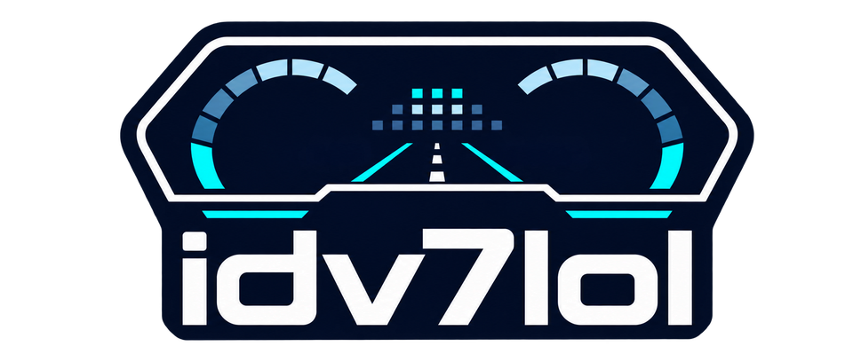
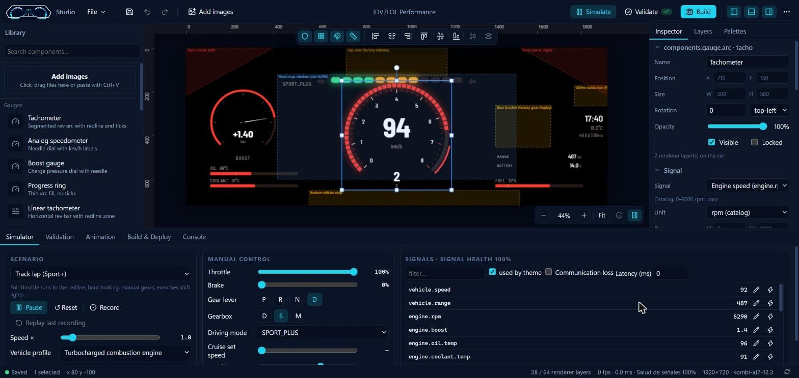
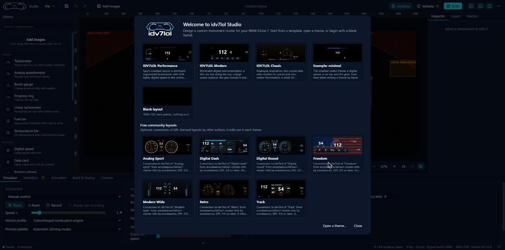
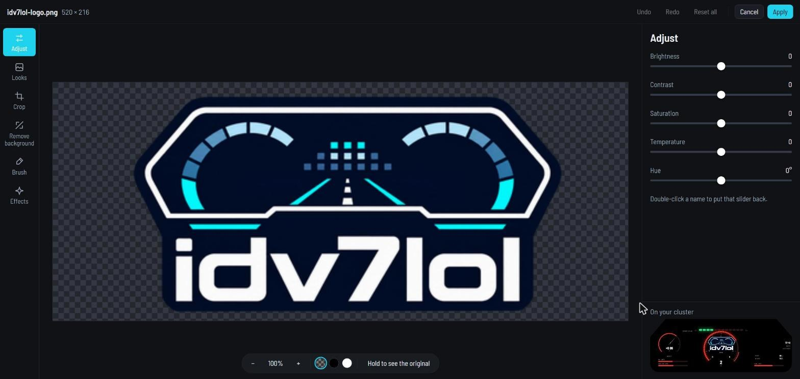
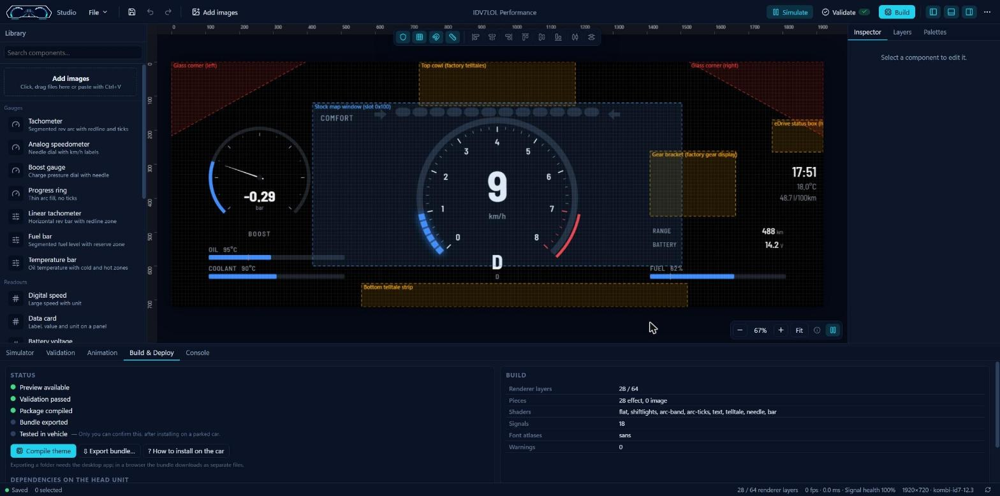
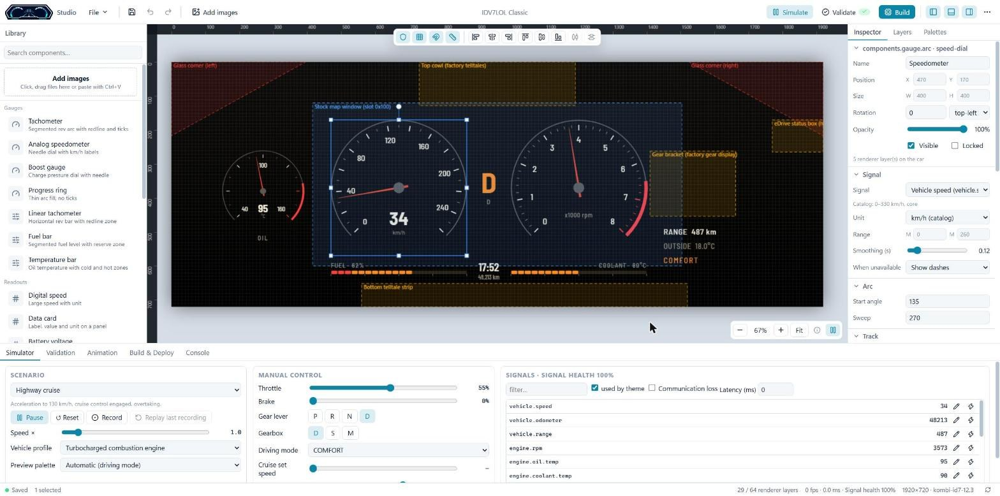
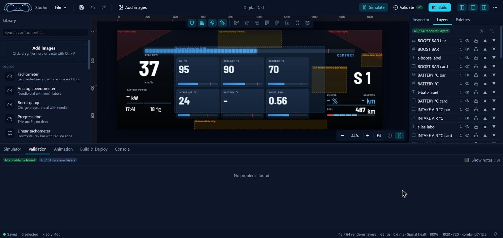
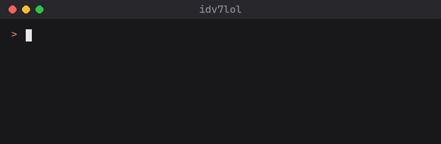

<p align="center"></p>

# idv7lol

Custom digital cluster layouts for BMW iDrive 7 (MGU) cars, plus a Windows editor to design them.

You draw your cluster on the PC, drive it with a simulated car to see how it behaves, check it
against the limits of the cluster renderer, and build a package that the
[MGU Store](https://github.com/robertnisipeanu/mgu-store) can install. When idv7lol is switched
off, the car shows its factory cluster again.

> **Disclaimer.** This is an unofficial hobby project. It has nothing to do with BMW AG. Changing
> what your cluster shows can distract you, and it may affect your warranty or break local rules.
> Use it parked or on a closed course, keep the factory warnings visible, and read
> [SECURITY.md](SECURITY.md) first.

**Status: 0.2.0-beta.1, an experimental pre-release.** First car test done: on a 2021 X4 M
Competition (iDrive 7) the app installed from the MGU Store, drew the Performance and Supercar
Track themes on the cluster, and switching it off brought the factory cluster back. USB themes,
pictures and animations haven't been tried on a car yet. Details in
[docs/PROJECT_STATUS.md](docs/PROJECT_STATUS.md).

**Download:** the Windows installer of idv7lol Studio is on the
[Releases page](https://github.com/ALMSTRA/idv7lol/releases). It isn't signed, so Windows
SmartScreen warns the first time; choose _More info_ and _Run anyway_.

## Screenshots

The editor with the Performance theme while the simulator drives a track lap:



The welcome window, where you start from a template, open a theme or begin with an empty layout:



| Image editor                                              | Build & Deploy                                                             |
| --------------------------------------------------------- | -------------------------------------------------------------------------- |
|  |  |

| Light mode, Classic theme                                               | Community template: Digital Dash                                |
| ----------------------------------------------------------------------- | --------------------------------------------------------------- |
|  |  |

These are screenshots of the Studio running on a PC. They are not photos of a car.

## What you get

- **idv7lol Studio**, the Windows editor. Drag gauges, bars, readouts and text onto the layout,
  import pictures, GIFs or short videos and edit them, try it with the simulator, and build.
- **Themes to start from.** Performance, Modern, Classic, Night Minimal (a calm night layout),
  Rally Dash (LED strip, rev bar, huge gear and data cards) and Supercar Track (a wide rev arc and a
  huge gear, in the style of Italian supercar track clusters), plus seven free community layouts
  converted from eroobeeroo's Cluster Layouts (GPL, credited in each theme).
- **The car app**, which runs on the head unit, draws the active theme through `cluster-render`,
  and lets you turn it on or off and switch themes from the iDrive menu.
- **The pieces behind them:** a signal catalog, the theme format, a renderer for the PC preview,
  a simulator and the compiler that turns a theme into what the car runs.

## Where things stand

| Part                                         | State                                        |
| -------------------------------------------- | -------------------------------------------- |
| Signals, theme format, engine, simulator     | written, covered by tests, published         |
| Compiler (GLSL layers, SDF fonts, validator) | written, covered by tests, published         |
| Bundled themes                               | pass validation, compiled into the car app   |
| idv7lol Studio for Windows                   | tested on a PC, unsigned installer released  |
| Car app (Node 8)                             | installs and draws on a car (one car so far) |
| Tested in a vehicle                          | **yes**, X4 M Competition 2021, two themes   |

## Building it

You need Node.js 20 or newer (24 works best) and npm 10. For the desktop app you also need Rust
(MSVC toolchain), Visual Studio Build Tools 2022 with the C++ workload, and WebView2.

```bash
git clone https://github.com/ALMSTRA/idv7lol.git
```

```bash
cd idv7lol && npm install
```

```bash
npm test
```

```bash
npm run tauri:dev
```

There is more in [docs/QUICKSTART.md](docs/QUICKSTART.md) and
[docs/developer/BUILD.md](docs/developer/BUILD.md). Spanish speakers can start with
[docs/user/GUIA_USUARIO_ES.md](docs/user/GUIA_USUARIO_ES.md).

## Putting it on the car

> These steps have worked on one car so far. Do them parked with the car on stable power, and know
> how to remove the app before you start (last step below). The full guide is
> [docs/user/DEPLOYMENT.md](docs/user/DEPLOYMENT.md).

You need a BMW with an iDrive 7 (MGU) head unit and the
[MGU Store](https://github.com/robertnisipeanu/mgu-store) installed on it. Installing the Store
needs root SSH access once; its README explains how.

> **Heads-up before the SSH unlock:** the flash that enables SSH erases the head unit's coding.
> Its settings reset, the Store refuses to install until the unit is coded again (BimmerCode or
> E-Sys), and Digital Key pairings are usually lost. Back up your coding first and flash only once.
> Details in [DEPLOYMENT.md](docs/user/DEPLOYMENT.md#before-you-install-the-mgu-store-the-ssh-unlock-erases-the-head-units-coding).

1. In the Store on the car, open **Settings**, then **Sources**, then **Add GitHub repository**,
   and enter `ALMSTRA/idv7lol` with the **Branch** channel and `main`. Don't pick Tags: the Store
   skips pre-release tags like `v0.2.0-beta.1`, so idv7lol doesn't show up there yet.
2. Open **idv7lol** in the list and press **Install**. The Store installs `cluster-render` first if
   it is missing, then builds idv7lol on the head unit. That takes about a minute.
3. Restart the head unit if the Store asks for it.
4. Open the **idv7lol** app from the apps menu. Nothing is drawn on the cluster until you press
   **Show on the cluster**, and the layout only appears while car data is live.
5. Pick the theme and palette with **Next theme** and **Palette**, or in the app's settings.
6. To go back to the factory cluster, turn **Show on the cluster** off. To uninstall, use
   **Remove** in the Store's list of installed apps.

No internet on the head unit? Copy the repository to a USB stick and add it in the Store with
**Add from USB**. The Store builds it the same way.

### Your own theme, with a USB stick

Once idv7lol 0.2.0 or newer is on the car, your own themes go over on a USB stick. No GitHub, no
rebuild and no internet.

1. In the Studio, open **Build & Deploy**, press **Compile theme**, then **Save for the car (USB)**
   and pick your USB stick. The theme is saved as `idv7lol/themes/<theme>.idv7pkg` on the stick.
2. Plug the stick into the car with the idv7lol app open. Within a few seconds the app finds the
   theme, checks it and installs it. The app page says what it installed, or why a file was
   refused.
3. Press **Next theme** until your theme shows. Nothing changes on the cluster before that.
4. To delete it, show it and press **Remove USB theme**. Themes built into the app can't be removed. If the
   file is still on the stick, it installs again the next time you plug the stick in.

The car checks every package before installing it: layer count, image sizes, renderer memory,
that everything sits on the panel and that it only names shaders the app already has. Packages
carry no shader code of their own. Up to 20 themes can be installed this way.

The USB path hasn't been tried on a car yet. In particular, it is not confirmed that the app can
read the stick. Cluster Layouts writes its logs to sticks in the same place, which is a good sign.

### Changing the built-in themes

To change the themes that come inside the app, fork this repository, put the theme in your fork as
`themes/<your-theme>/theme.json`, check it and regenerate the car files:

```bash
npm run themes:validate
```

```bash
npx tsx tools/build/build-mgu-themes.ts
```

Then commit, push, and add your fork in the Store instead of `ALMSTRA/idv7lol`.

On the car, fuel level, range and the 12 V battery are not read yet and show dashes. Opacity
animations don't play there either. The current list of known limits is in the deployment guide.

## How it works

A theme is a JSON file (`themes/<id>/theme.json`) with a list of components. Each one reads a
signal such as `engine.rpm` and takes its colours from the theme's palette. The Studio edits that
file and draws it on a canvas. For the car, the compiler turns the same file into one small GLSL
ES 1.00 shader layer per piece (the renderer allows 64 per app), a glyph atlas for text, and data
for a Node 8 app. That app reads vehicle signals over SOME/IP and feeds them to `cluster-render`,
which passes the scene to the cluster's own RAMSES renderer. Turning the app off removes the
layers, and the factory cluster comes back.

## Docs

- [Architecture](docs/architecture/ARCHITECTURE.md) and [renderer notes](docs/architecture/RENDERER.md)
- [Making themes](docs/developer/THEME_DEVELOPMENT.md), [components](docs/developer/COMPONENT_API.md)
  and [signals](docs/developer/SIGNALS.md)
- [Building](docs/developer/BUILD.md), [installing on the car](docs/user/DEPLOYMENT.md),
  [compatibility](docs/compatibility/COMPATIBILITY.md) and
  [troubleshooting](docs/troubleshooting/TROUBLESHOOTING.md)
- [Project status](docs/PROJECT_STATUS.md) and [changelog](CHANGELOG.md)

## License and contributing

GPL-3.0-or-later. Third-party parts keep their own licences, listed in
[THIRD_PARTY_NOTICES.md](THIRD_PARTY_NOTICES.md).

Contributions are welcome, see [CONTRIBUTING.md](CONTRIBUTING.md). Ask questions in GitHub
Discussions. Report security problems privately as described in [SECURITY.md](SECURITY.md).

## Credits

idv7lol is built on top of other people's open-source work. Thank you to all of them.

- **[eroobeeroo/idrive7-cluster-info](https://github.com/eroobeeroo/idrive7-cluster-info)**:
  Cluster Layouts proved that a fully custom layout works on the KOMBI, and it is the project this
  one started from. Its seven layouts are included as free templates, converted to idv7lol's format
  (GPL-3.0-or-later, see [themes/community/README.md](themes/community/README.md)).
- **[cauliflowermossgrape/idrive7-apps](https://github.com/cauliflowermossgrape/idrive7-apps)**:
  the app kit and GPU renderer. The kit is included in `kit/` under the MIT licence.
- **[robertnisipeanu/idrive-apps](https://github.com/robertnisipeanu/idrive-apps)**:
  `cluster-render`, the service that draws on the cluster. Its client is included under MPL-2.0.
- **[robertnisipeanu/mgu-store](https://github.com/robertnisipeanu/mgu-store)**: the Store that
  installs apps on the head unit.
- **[Barlow](https://github.com/jpt/barlow)** by Jeremy Tribby (SIL Open Font License) for the
  cluster font, and **[Lucide](https://lucide.dev)** (ISC) for the editor's icons.

Full licence details are in [THIRD_PARTY_NOTICES.md](THIRD_PARTY_NOTICES.md).

### Made with Claude Code

[Claude Code](https://claude.com/claude-code) measured its own share from its session logs on
2026-11-11: about **80%** of the code and docs match lines it wrote (60% counting the themes'
data files, which scripts and the Studio produce). The rest is the author's own work, or was
reformatted or generated afterwards. Vendored code (`kit/`, the renderer client) and generated
files are left out of the count.

<p align="center"></p>
